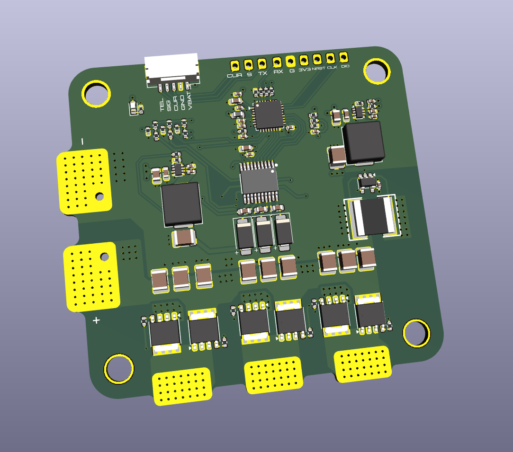
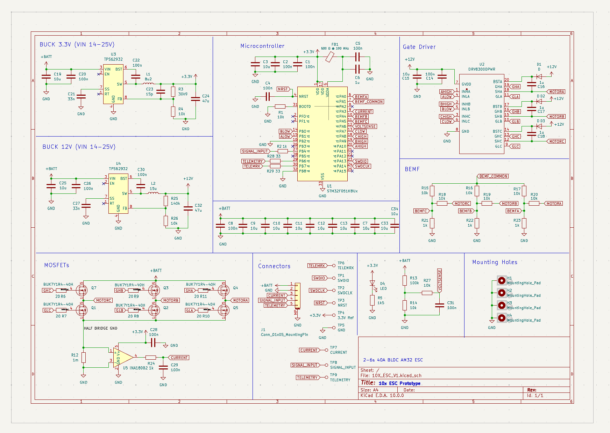
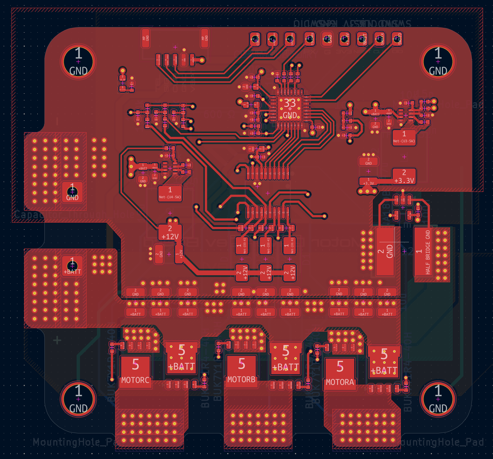
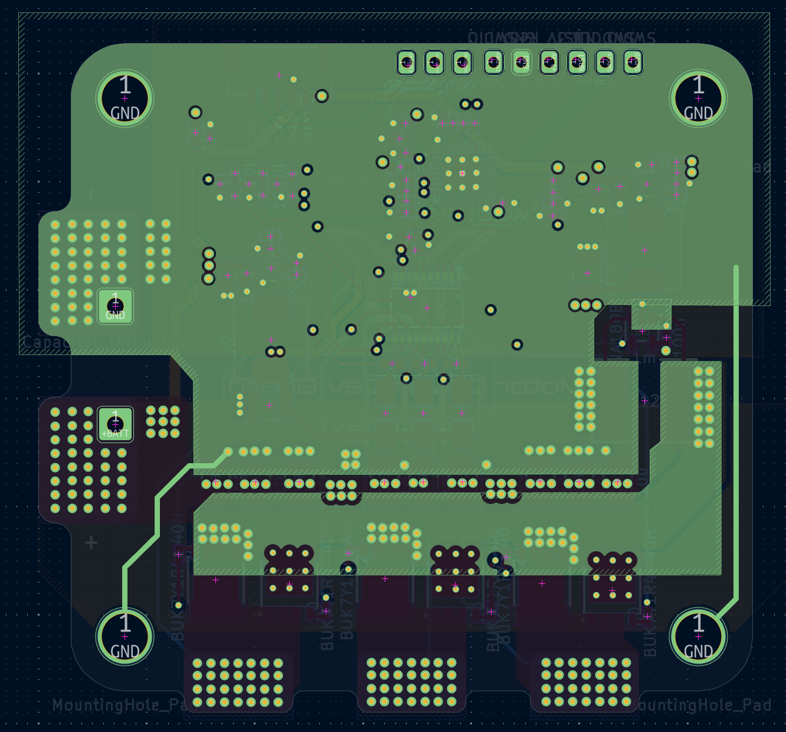
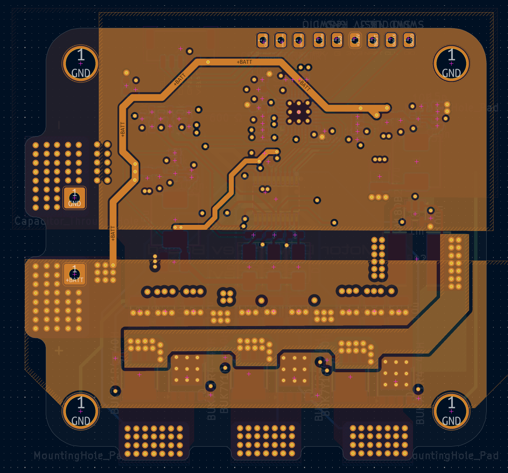
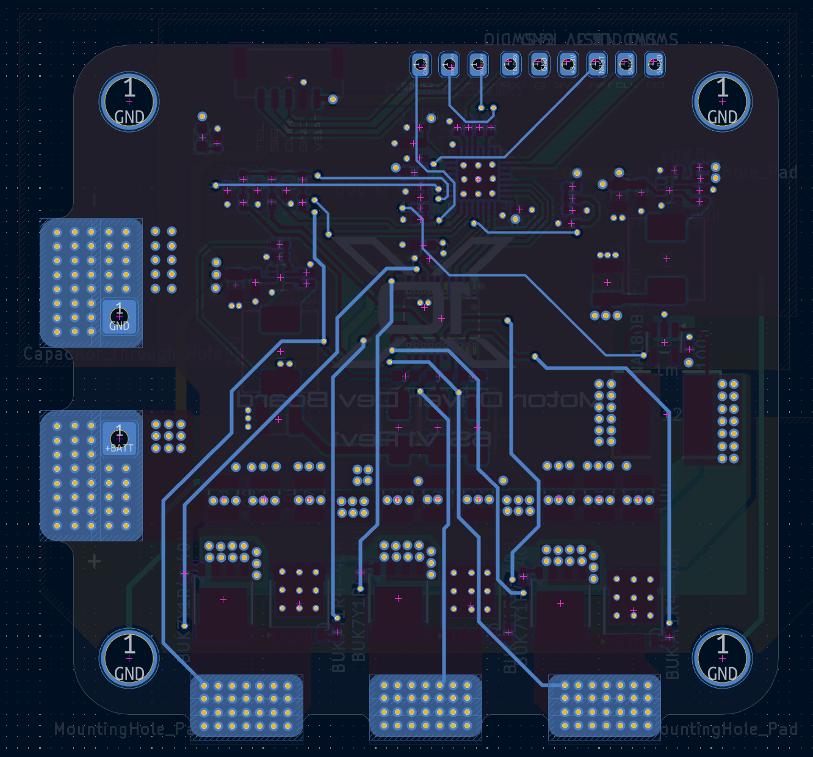
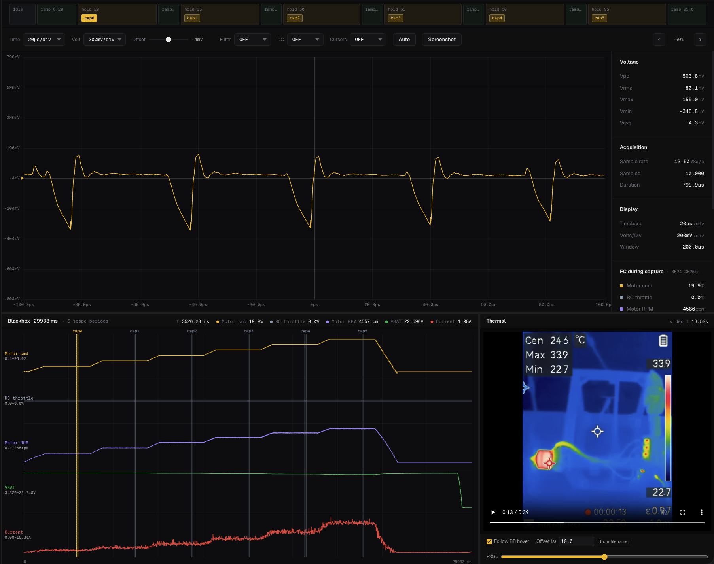
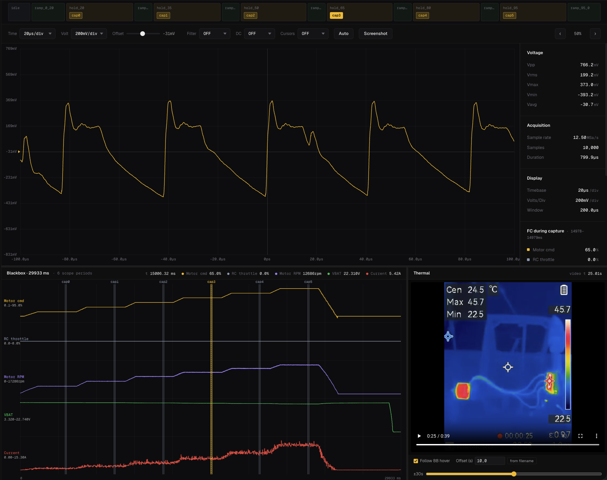
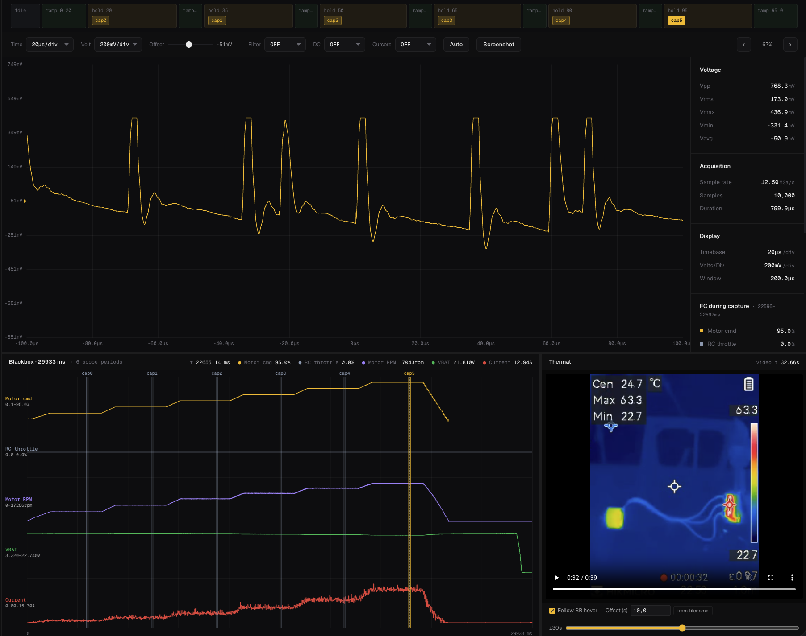

# 10x ESC: 2-6S BLDC Speed Controller (Rev 1 Prototype)

A custom brushless motor controller designed from scratch in KiCad: a three-phase power stage, isolated-rail gate drive, two on-board buck converters, back-EMF sensing, and current and voltage telemetry. It runs the open-source [AM32](https://github.com/am32-firmware/AM32) firmware on an STM32F051.

**Status:** Rev 1, built and bench-tested on a 6S LiPo with an AOS Supernova 3220 925KV motor and 7x7 prop, up to **15.3 A peak (about 280 W input)**. The design target is 40 A; testing beyond 15.3 A is still to do (see [Roadmap](#roadmap-rev-2)).



## Key specs

| | |
|---|---|
| Design target | 40 A, 6S LiPo (25.2 V max) |
| Validated so far | 15.3 A peak logged, 12.9 A held at 95% throttle, 6S |
| Input range | Buck converters designed for 14-25 V in (see [Known issues](#known-issues)) |
| MCU | STM32F051 (Cortex-M0) |
| Firmware | AM32 (open source, GPL-3.0) |
| Power stage | 6x BUK7Y1R4-40H (40 V, ~1.4 mOhm N-channel MOSFETs), 3 half-bridges |
| Gate driver | TI DRV8300D (3-phase, bootstrap high-side drive), 20 Ohm gate resistors |
| Logic and gate supplies | 2x TPS62932 synchronous buck: 3.3 V (logic) and 12 V (gate drive), both from the battery |
| Current sense | 1 mOhm low-side shunt + INA180B2 current-sense amplifier |
| Position sensing | Sensorless back-EMF, resistor divider network to MCU ADC |
| Telemetry | Battery voltage divider, current output, bidirectional telemetry line to the flight controller |
| Debug | SWD header, test points for 3.3 V, GND, NRST, telemetry, signal, current |
| Tools | KiCad 10 |

## Design overview



- **Power stage:** three half-bridges of two BUK7Y1R4-40H MOSFETs each, with the shared low-side return passing through a 1 mOhm shunt. Wide copper pours and dense via arrays carry battery, ground and phase current.
- **Gate drive:** a DRV8300D drives all six gates from a 12 V rail. High-side supply comes from bootstrap capacitors; gate resistors set the edge rate.
- **Power supplies:** two TPS62932 buck converters run directly off the battery. One produces 3.3 V for the MCU and the other 12 V for gate drive, so the board needs no external regulator.
- **Back-EMF sensing:** each motor phase goes through a divider into the MCU ADC, with a virtual-neutral reference, so AM32 can detect rotor position without Hall sensors.
- **Current and voltage monitoring:** the INA180B2 amplifies the shunt voltage for overcurrent protection and telemetry; a 100k/10k divider scales battery voltage for the ADC.
- **Bring-up features:** SWD header and test points broken out along the board edge for flashing and debugging.

### PCB

| | |
|---|---|
|  |  |
| L1 (top): components, signal routing, power pours | L2: ground plane |
|  |  |
| L3: +BATT pour and routing | L4: signal routing and phase pads |

## Testing

### Setup

- **Motor:** AOS Supernova 3220 925KV
- **Battery:** 6S LiPo
- **Prop:** 7x7
- **Bulk capacitance:** 1000 uF
- **Logging:** flight-controller blackbox (throttle command, RPM, battery voltage, current), oscilloscope captures at each hold, thermal camera video
- **Scope measurement:** AC-coupled VBAT ripple, probed directly at the battery solder pads

The throttle sequence ramps 0 to 95% in steps, holding each level for 2 s while a scope capture is taken, then ramps down.

| Time (s) | Action | Throttle |
|---|---|---|
| 0.0 | Idle | - |
| 1.0 | Ramp | 0 to 20% |
| 2.5 | Hold (capture) | 20% |
| 4.5 | Ramp | 20 to 35% |
| 5.3 | Hold (capture) | 35% |
| 7.3 | Ramp | 35 to 50% |
| 8.1 | Hold (capture) | 50% |
| 10.1 | Ramp | 50 to 65% |
| 10.9 | Hold (capture) | 65% |
| 12.9 | Ramp | 65 to 80% |
| 13.7 | Hold (capture) | 80% |
| 15.7 | Ramp | 80 to 95% |
| 16.5 | Hold (capture) | 95% |
| 18.5 | Ramp down | 95 to 0% |
| 20.0 | End | - |

### Results (selected holds)

| Throttle | Current | Battery V | Motor RPM | Input power (V x I) | VBAT ripple (Vpp) | Max temp in frame |
|---|---|---|---|---|---|---|
| 20% | 1.08 A | 22.69 V | 4,557 | about 24 W | 504 mV | 33.9 C |
| 65% | 5.42 A | 22.31 V | 12,686 | about 121 W | 766 mV | 45.7 C |
| 95% | 12.94 A | 21.81 V | 17,043 | about 282 W | 768 mV | 63.3 C |

Ambient (coldest pixel) was about 22.5-22.7 C. Peak logged current across the run was 15.3 A. Input power is calculated from logged battery voltage and current.

| 20% throttle | 65% throttle | 95% throttle |
|---|---|---|
|  |  |  |

### Notes on the measurements

- **Switching frequency:** the scope shows a repeating pattern at roughly 40 us per period at 20% throttle, consistent with ~25 kHz PWM.
- **Ripple:** the measured ripple rises from 504 mV to about 770 mV and then stays flat while current rises another 2x. That suggests the reading is dominated by switching-edge spikes and probe-loop inductance at the battery pads rather than true bulk-capacitor ripple. A short-ground probe tip would give a more accurate figure (planned for Rev 2 testing).
- **Thermal:** temperature climbed steadily with load, from 33.9 C to 63.3 C at 95% throttle with no heatsinking and ambient near 22.7 C.

## Known issues

- **Redundant bootstrap diodes:** the DRV8300D has internal bootstrap diodes, so the external diodes (D1-D3) are unnecessary. Nothing breaks; it costs board area and a few parts.
- **Input range is narrower than the "2-6S" title suggests:** both buck converters are designed for 14-25 V input, and the 12 V gate-drive rail cannot be generated from a 2S or 3S pack. The board is intended for roughly 4S-6S, and has only been tested on 6S.
- **Current validated to 15.3 A, not 40 A:** the 40 A figure is the design target (MOSFET and copper sizing), not a tested rating.

## Roadmap (Rev 2)

- Remove the redundant bootstrap diodes
- Revisit the gate-drive supply to widen the usable input range
- Repeat VBAT ripple measurement with a short-ground probe
- Measure the phase node and gate waveforms (dead time, ringing)
- Higher-current testing on a dynamometer or heavier load, with identified hot-spot components, to validate toward the 40 A target
- Add efficiency measurement (mechanical output vs. electrical input)

## Repository layout

```
hardware/    KiCad project, gerbers, BOM
images/      schematic, PCB layers, 3D render, test captures
firmware/    notes on AM32 target / configuration
docs/        design notes
```

## Credits and licensing

Firmware is the upstream [AM32](https://github.com/am32-firmware/AM32) project (GPL-3.0). The hardware in this repository is my own design.
